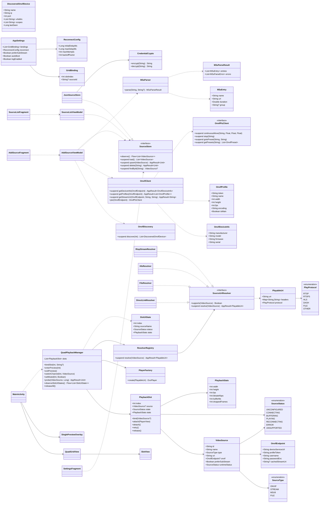
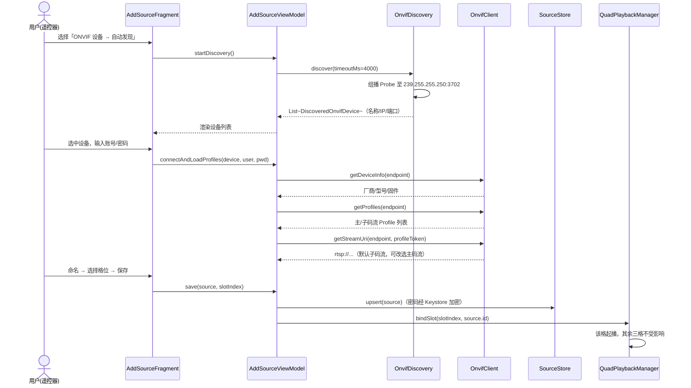
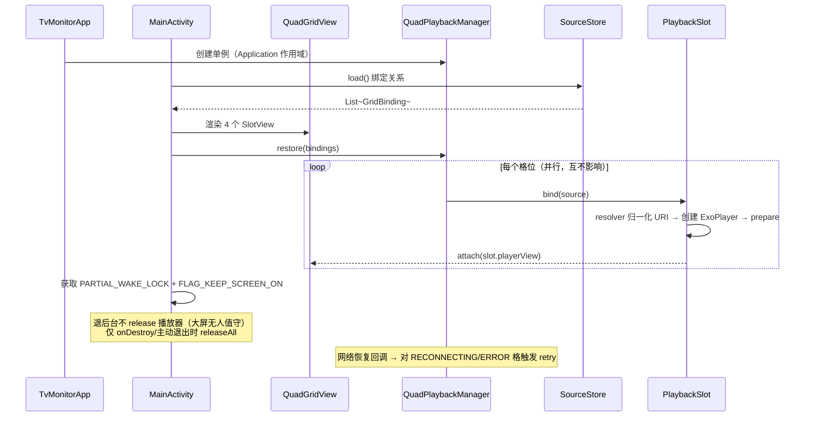
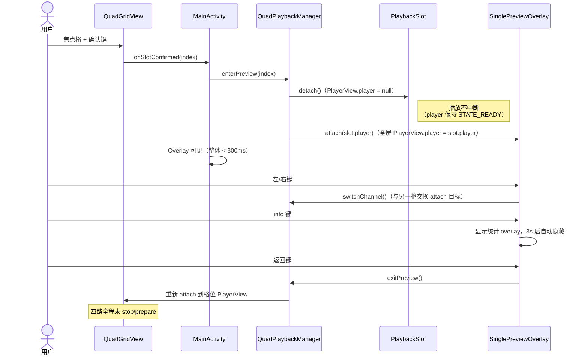
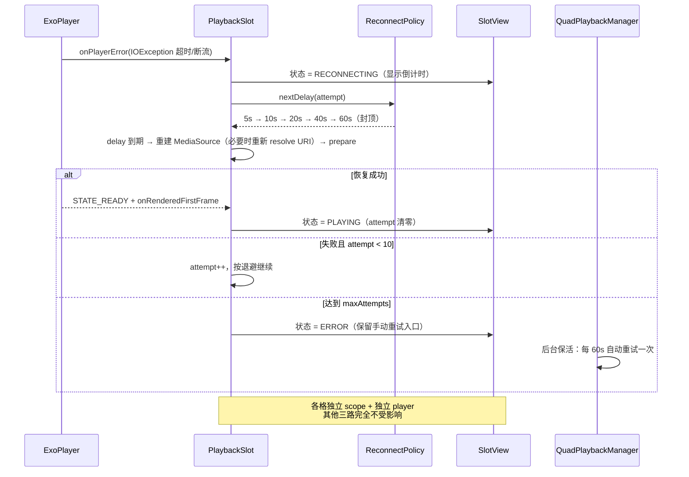
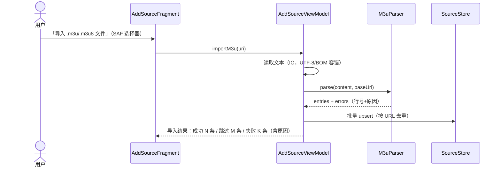

# ARCHITECTURE：TV 监控四分格播放器（tv-monitor）

| 项目 | 内容 |
|---|---|
| 文档版本 | v1.0 |
| 日期 | 2026-10-24 |
| 作者 | 高见远（软件架构师） |
| 状态 | 待评审（转交工程师实现） |
| 依据 | PRD v1.0（许清楚）+ 主理人齐活林对 PRD 6 个待确认问题的裁决 |
| 界面/文档语言 | 简体中文 |

## 0. 设计目标与关键约束（来自 PRD 与裁决，作为设计输入）

1. **P0 协议边界**：rtsp/rtsps + HLS(m3u8) + 本地视频文件 + ONVIF 四类；用户输入 rtmp/http-flv 时给出明确"暂不支持"提示；架构必须预留协议扩展点（`SourceUriResolver` 策略接口），P2 再扩展。
2. **PTZ** 保留 P1：架构预留 `OnvifPtzClient` 接口（默认空实现），单预览态可扩展。
3. **无账号体系**：单用户本机使用，无登录/权限。
4. **ONVIF 添加时**拉取主/子码流列表供选择，默认推荐子码流（`preferSubStream=true`）。
5. **WakeLock 防休眠列入 P0**：`PARTIAL_WAKE_LOCK` + 窗口 `FLAG_KEEP_SCREEN_ON` + ExoPlayer `WAKE_MODE_NETWORK`。
6. **本地格式**以 media3 能力为准，失败给明确提示。
7. 4 路独立解码互不影响；2GB RAM 低端盒子可运行；进入/返回单预览 < 1s 且四路播放不中断。
8. 账号密码本地加密存储（Android Keystore）；不收集、不上传用户数据。

---

## 1. 技术选型与版本

> 全局说明：下表版本为 **2026-10 时点的合理稳定版**，**以构建时各官方渠道最新稳定版为准**；升级时须保持兼容矩阵（AGP ↔ Gradle ↔ Kotlin ↔ compileSdk ↔ media3）。

| 类别 | 选型 | 建议版本 | 选型理由 |
|---|---|---|---|
| 语言 | Kotlin | 2.0.21 | 空安全 + 协程原生支持；media3/AndroidX 均 Kotlin 友好 |
| 构建 | Gradle + AGP | 8.10.2 / 8.7.3 | AGP 8.x 与 Gradle 8.9+ 兼容矩阵成熟 |
| JDK | Java 17（toolchain） | 17 | AGP 8.x 要求 |
| SDK | compileSdk 35 / minSdk 24 / targetSdk 34 | — | 覆盖 Android TV 7.0+；targetSdk 34 与 PRD 一致 |
| 播放内核 | media3 ExoPlayer（`media3-bom` 统一版本） | 1.5.x（≥1.4.1） | Google 官方维护、TV 兼容性验证充分；NFR-06 要求统一播放内核；一套内核覆盖 RTSP/HLS/DASH/本地文件 |
| RTSP | `media3-exoplayer-rtsp` | 同 media3 | ONVIF 摄像头 rtsp/rtsps 直驱，避免自研 RTSP/RTP 协议栈（自研风险极高） |
| HLS | `media3-exoplayer-hls` | 同 media3 | m3u8 直播/点播，含主播放列表多码率自适应 |
| DASH | `media3-exoplayer-dash` | 同 media3 | 成本极低，兼容部分平台 dash 直播源 |
| 播放视图 | `media3-ui`（PlayerView） | 同 media3 | 成熟 SurfaceView 渲染与 letterbox 缩放 |
| HTTP 数据源 | `media3-datasource-okhttp` | 同 media3 | HLS/文件走 OkHttp，与 ONVIF 客户端复用连接池与 DNS |
| 网络库 | OkHttp | 4.12.0 | ONVIF SOAP 传输；4.x 分支稳定，Kotlin 友好 |
| 异步 | kotlinx-coroutines-android | 1.9.0 | 结构化并发；每路播放独立 scope 实现隔离 |
| JSON | kotlinx.serialization-json | 1.7.3 | 编译期序列化、无反射、Kotlin 优先（源库/设置持久化） |
| UI 框架 | Views + AppCompat + ConstraintLayout + RecyclerView + Material | core-ktx 1.15.0 / appcompat 1.7.0 / constraintlayout 2.1.4 / recyclerview 1.3.2 / material 1.12.0 | TV D-pad 焦点体系用 Views 最可控；PlayerView 直接复用；低端盒子无 Compose 运行时开销 |
| 文件浏览 | androidx.documentfile | 1.0.1 | SAF（`ACTION_OPEN_DOCUMENT`）浏览 U 盘/本地文件 |
| 测试 | JUnit4 + kotlinx-coroutines-test + LeakCanary（debugOnly） | 4.13.2 / 1.9.0 / 2.14 | 解析器/存储可 JVM 单测；LeakCanary 验证 7x24 无泄漏 |
| 加密 | 系统 AndroidKeyStore（AES-256-GCM） | 系统 API 23+ | 密钥不可导出，无需引入第三方库 |

### 1.1 media3-rtsp 的使用方式与限制（重点）

**使用方式**：
- 引入 `media3-exoplayer-rtsp` 后，`DefaultMediaSourceFactory` 会自动识别 `rtsp://` 与 `rtsps://` scheme 并创建 `RtspMediaSource`（media3 通过类探测完成扩展模块注册，无需手写绑定代码）；如需显式控制可自行组装 `MediaSource.Factory`。
- 播放链路：`SourceUriResolver` 归一化出 RTSP URI（凭据以 `user:pass@` 内嵌）→ `PlayerFactory` 构造 `MediaItem` → `RtspMediaSource` → `RtpDataChannel`（UDP）或 TCP interleaved → `MediaCodec` 硬解 → `PlayerView(SurfaceView)`。
- ONVIF 设备播放前通常先经 `OnvifClient.getStreamUri()` 取回媒体 URI；`OnvifEndpoint.cachedStreamUri` 缓存，重连失败时重新解析（设备换 IP/重启后 URI 可能变化）。

**能力边界（写入代码注释与用户提示文案）**：
1. 支持 RTP over UDP 单播、TCP interleaved、RTSP DESCRIBE/SETUP/PLAY/TEARDOWN、OPTIONS keep-alive、Basic 鉴权（URL 内嵌凭据）。
2. **不支持 RTSP over HTTP 隧道**：个别摄像头/NVR 默认仅开放该模式，将无法播放，需提示用户改直连或更换设备。
3. 不支持组播 RTP、RTSP 2.0 服务端播放列表、厂商私有加密流。
4. H.264/H.265 可解性取决于设备硬解能力；弱网 UDP 丢包表现为花屏/卡顿，无 FEC（现场优先子码流）。
5. `rtsps://` 自签名证书的兼容性需真机确认。
6. **RTMP/HTTP-FLV（P0 不支持）**：`media3-datasource-rtmp` 在 P2 可评估（仅 RTMP 且有局限）；HTTP-FLV 需自研 FLV 解封装 DataSource，列入 P2+。P0 阶段 `DirectLinkResolver` 遇到 `rtmp://`/`http*flv` 返回 `UNSUPPORTED` + 明确文案。

### 1.2 版本目录（gradle/libs.versions.toml 摘要）

```toml
[versions]
agp = "8.7.3"
kotlin = "2.0.21"
coreKtx = "1.15.0"
appcompat = "1.7.0"
material = "1.12.0"
constraintlayout = "2.1.4"
recyclerview = "1.3.2"
fragmentKtx = "1.8.5"
lifecycle = "2.8.7"
coroutines = "1.9.0"
serialization = "1.7.3"
okhttp = "4.12.0"
media3 = "1.5.0"
documentfile = "1.0.1"
junit = "4.13.2"
leakcanary = "2.14"
```

---

## 2. 工程结构

### 2.1 目录树

```
tv-monitor/
├── settings.gradle.kts
├── build.gradle.kts                     # 根构建脚本（插件版本声明）
├── gradle.properties
├── gradle/
│   ├── libs.versions.toml               # 版本目录（统一依赖版本）
│   └── wrapper/gradle-wrapper.properties
└── app/
    ├── build.gradle.kts                 # 应用模块构建脚本
    ├── proguard-rules.pro
    └── src/
        └── main/
            ├── AndroidManifest.xml
            ├── res/
            │   ├── layout/              # 6 个布局（见文件清单）
            │   ├── values/              # strings.xml / themes.xml（含 colors/dimens）
            │   ├── drawable/            # 焦点描边 selector、状态点、占位图、图标
            │   └── xml/network_security_config.xml
            └── java/com/tvmonitor/
                ├── TvMonitorApp.kt                  # Application 入口
                ├── MainActivity.kt                  # 唯一 Activity（含 SinglePreviewOverlay）
                ├── data/
                │   ├── model/Models.kt              # 全部数据模型
                │   ├── SourceStore.kt               # 源库接口 + JSON 实现
                │   ├── CredentialCrypto.kt          # Keystore 凭据加解密
                │   └── m3u/M3uParser.kt             # M3U 播放列表解析
                ├── onvif/
                │   ├── OnvifSoap.kt                 # SOAP 信封/WS-Security/XmlPullParser
                │   ├── OnvifDiscovery.kt            # WS-Discovery 组播发现
                │   └── OnvifClient.kt               # ONVIF 设备客户端（含 PTZ 接口）
                ├── playback/
                │   ├── QuadPlaybackManager.kt       # 四路播放编排（含 PlayerFactory）
                │   ├── PlaybackSlot.kt              # 单路播放抽象（状态机/重连/统计）
                │   └── SourceUriResolver.kt         # 协议扩展点 + 各协议解析器
                ├── ui/
                │   ├── quad/QuadGridView.kt         # 2x2 网格 + 焦点矩阵 + SlotView
                │   ├── source/SourceListFragment.kt # 源管理（含 SourceListViewModel）
                │   ├── source/AddSourceFragment.kt  # 添加源向导（含 AddSourceViewModel）
                │   └── settings/SettingsFragment.kt  # 设置
                └── util/Common.kt                   # TvLog + AppResult + 全局常量
```

### 2.2 包结构约定（com.tvmonitor.*）

| 包 | 职责 | 允许依赖 |
|---|---|---|
| `com.tvmonitor` | Application、Activity | ui、playback、data |
| `com.tvmonitor.data` | 模型、源库持久化、凭据加密、M3U 解析 | util |
| `com.tvmonitor.onvif` | WS-Discovery、SOAP 客户端、PTZ 接口 | data、util |
| `com.tvmonitor.playback` | 播放编排、单路抽象、协议解析 | data、util |
| `com.tvmonitor.ui.*` | 界面与交互（Fragments/自定义 View） | playback、data、onvif |
| `com.tvmonitor.util` | 日志、Result 封装、常量 | 无 |

依赖方向单向向下：ui → playback/onvif → data → util；**播放层不得依赖 ui 层**（通过 attach/detach 接口交互）。

### 2.3 app/build.gradle.kts 关键配置摘要

```kotlin
android {
    namespace = "com.tvmonitor"
    compileSdk = 35
    defaultConfig { minSdk = 24; targetSdk = 34; versionCode = 1; versionName = "1.0.0" }
    kotlinOptions { jvmTarget = "17" }
    buildFeatures { viewBinding = true }
    buildTypes {
        debug { applicationIdSuffix = ".debug" }
        release { isMinifyEnabled = true; proguardFiles(...) }
    }
}
// plugins: com.android.application / org.jetbrains.kotlin.android / kotlinx-serialization
// 关键依赖：media3-bom + exoplayer + exoplayer-rtsp + exoplayer-hls + exoplayer-dash
//           + ui + datasource-okhttp；okhttp；coroutines；serialization-json
```

---

## 3. 完整文件清单（35 项）

### A. 构建配置（7）

| # | 相对路径 | 职责 |
|---|---|---|
| 1 | `settings.gradle.kts` | Gradle 设置：插件仓库、模块声明（`:app`） |
| 2 | `build.gradle.kts`（根） | 根脚本：以 apply false 声明 AGP/Kotlin/序列化插件版本 |
| 3 | `gradle.properties` | JVM 参数（`-Xmx4g`）、`android.useAndroidX=true`、非传递 R 类等 |
| 4 | `gradle/libs.versions.toml` | 版本目录：全部第三方依赖与插件版本（见 1.2） |
| 5 | `gradle/wrapper/gradle-wrapper.properties` | 固定 Gradle 8.10.2 分发 |
| 6 | `app/build.gradle.kts` | 应用模块：SDK 版本、viewBinding、media3/OkHttp 等依赖、debug/release 构建类型 |
| 7 | `app/proguard-rules.pro` | 混淆规则：保留 media3/kotlinx.serialization 必要规则 |

### B. 清单与入口（3）

| # | 相对路径 | 职责 |
|---|---|---|
| 8 | `app/src/main/AndroidManifest.xml` | LEANBACK_LAUNCHER intent-filter、权限（INTERNET/ACCESS_NETWORK_STATE/ACCESS_WIFI_STATE/WAKE_LOCK/RECEIVE_BOOT_COMPLETED/READ_MEDIA_VIDEO/READ_EXTERNAL_STORAGE(max32)）、`usesCleartextTraffic`、Activity 横屏锁定、networkSecurityConfig 引用 |
| 9 | `app/src/main/java/com/tvmonitor/TvMonitorApp.kt` | Application：初始化 TvLog、构建全局 QuadPlaybackManager/SourceStore 单例（Application 作用域，跨 Activity 重建不中断播放） |
| 10 | `app/src/main/res/xml/network_security_config.xml` | 允许内网 http cleartext（ONVIF SOAP/部分 HLS 为 http；后续可按域名收紧） |

### C. UI 层源码（5）

| # | 相对路径 | 职责 |
|---|---|---|
| 11 | `app/src/main/java/com/tvmonitor/MainActivity.kt` | 唯一 Activity：承载 QuadGridView、底部提示条、Fragment 容器、SinglePreviewOverlay（内部类）；WakeLock/FLAG_KEEP_SCREEN_ON；全局按键分发（菜单=源管理、返回=退出确认）；进出单预览编排 |
| 12 | `app/src/main/java/com/tvmonitor/ui/quad/QuadGridView.kt` | 自定义 ViewGroup：程序化装载 4 个 SlotView 按 2x2 排布；D-pad 焦点矩阵（nextFocus 声明式 + 越界不 wrap）；确认键回调；内部类 `SlotView`：PlayerView 宿主 + 源名/状态角标/重连倒计时浮层 + 焦点描边 selector |
| 13 | `app/src/main/java/com/tvmonitor/ui/source/SourceListFragment.kt` | 源管理列表：RecyclerView（首行"添加源"特殊项）、菜单键弹出操作菜单（编辑/删除/测试播放/绑定到格位）；内含 `SourceListViewModel`（CRUD、状态轮询） |
| 14 | `app/src/main/java/com/tvmonitor/ui/source/AddSourceFragment.kt` | 添加源向导：类型选择 → ONVIF 自动发现/手动表单/直链输入/m3u8 导入/文件选择 → 码流选择 → 命名 + 选格位 + 保存；内含 `AddSourceViewModel`（发现、拉取 Profiles、测试连接、保存） |
| 15 | `app/src/main/java/com/tvmonitor/ui/settings/SettingsFragment.kt` | 设置：重连策略（初始/最大延迟、最大次数）、默认静音、子码流优先、日志开关、开机自启（P2 预留开关） |

### D. 布局（6）

| # | 相对路径 | 职责 |
|---|---|---|
| 16 | `app/src/main/res/layout/activity_main.xml` | FrameLayout 根（keepScreenOn）：QuadGridView + 底部提示条 + Fragment 容器 + SinglePreviewOverlay(默认 gone) |
| 17 | `app/src/main/res/layout/view_slot.xml` | SlotView 内部：PlayerView（surface_view、resize_mode=fit、无控制器）+ 源名 + 状态点 + 重连倒计时 TextView |
| 18 | `app/src/main/res/layout/fragment_source_list.xml` | 源列表：RecyclerView（vertical）+ 标题栏 + 分组筛选入口（P1 预留） |
| 19 | `app/src/main/res/layout/item_source.xml` | 列表行（含"添加源"行/ONVIF 设备行/码流选择行复用）：名称 + 类型 + 地址 + 状态点 |
| 20 | `app/src/main/res/layout/fragment_add_source.xml` | 向导步骤容器（ViewFlipper）：4 类型项 + ONVIF 表单/发现结果 + 直链/m3u8/文件表单 + 命名/格位/保存 |
| 21 | `app/src/main/res/layout/fragment_settings.xml` | 设置项行（可聚焦行 + Switch/步进值） |

### E. 值资源与图形（3）

| # | 相对路径 | 职责 |
|---|---|---|
| 22 | `app/src/main/res/values/strings.xml` | 全部用户可见文案（简体中文默认；英文后续 values-en） |
| 23 | `app/src/main/res/values/themes.xml` | TV 主题（含 colors：主题色/状态色；dimens：描边 3dp、角标字号等） |
| 24 | `app/src/main/res/drawable/`（一组小资源） | `slot_focus_border.xml`（焦点描边 selector）、`status_dot.xml`（状态点 selector）、`overlay_scrim.xml`（半透明底）、`ic_placeholder.xml`（无信号占位）、launcher 图标等 |

### F. 数据层（4）

| # | 相对路径 | 职责 |
|---|---|---|
| 25 | `app/src/main/java/com/tvmonitor/data/model/Models.kt` | 全部数据模型：SourceType/SourceStatus 枚举、VideoSource、OnvifEndpoint、OnvifProfile、OnvifDeviceInfo、DiscoveredOnvifDevice、GridBinding、ReconnectConfig、AppSettings |
| 26 | `app/src/main/java/com/tvmonitor/data/SourceStore.kt` | `SourceStore` 接口（observe/load/upsert/delete/findById）+ `JsonSourceStore` 实现（filesDir JSON、内存缓存、原子写、Flow 通知） |
| 27 | `app/src/main/java/com/tvmonitor/data/CredentialCrypto.kt` | Keystore AES-256-GCM 加解密（`v1:<iv>:<ct>` 格式），仅供 JsonSourceStore 调用 |
| 28 | `app/src/main/java/com/tvmonitor/data/m3u/M3uParser.kt` | M3U/M3U8 播放列表解析（EXTINF 属性、相对地址解析、去重、容错、结果汇总） |

### G. ONVIF 协议层（3）

| # | 相对路径 | 职责 |
|---|---|---|
| 29 | `app/src/main/java/com/tvmonitor/onvif/OnvifSoap.kt` | WS-Discovery 报文构建/解析、SOAP 1.2 信封、WS-Security UsernameToken(Digest) 头、XmlPullParser 流式解析、SOAP Fault 识别 |
| 30 | `app/src/main/java/com/tvmonitor/onvif/OnvifDiscovery.kt` | MulticastSocket 组播 Probe（239.255.255.250:3702）、超时收集 ProbeMatch、解析 XAddrs/Scopes |
| 31 | `app/src/main/java/com/tvmonitor/onvif/OnvifClient.kt` | OkHttp 传输的 ONVIF 客户端：GetDeviceInformation/GetServices/GetProfiles/GetStreamUri；内含 `OnvifPtzClient` 接口与 `NoOpOnvifPtzClient`（P1 预留） |

### H. 播放层（3）

| # | 相对路径 | 职责 |
|---|---|---|
| 32 | `app/src/main/java/com/tvmonitor/playback/QuadPlaybackManager.kt` | 四路播放编排：4 个 PlaybackSlot 生命周期、绑定/解绑、进入/退出单预览、切路、静音、测试播放（临时 slot）、网络恢复联动、状态 Flow；内含 `PlayerFactory`（ExoPlayer/LoadControl/TrackSelector/MediaSource 组装） |
| 33 | `app/src/main/java/com/tvmonitor/playback/PlaybackSlot.kt` | 单路抽象：ExoPlayer 托管、attach/detach 视图、状态机（SourceStatus）、指数退避重连（ReconnectConfig）、首帧 watchdog、统计（分辨率/帧率/码率/缓冲/丢帧）、错误分类 |
| 34 | `app/src/main/java/com/tvmonitor/playback/SourceUriResolver.kt` | 协议扩展点：`SourceUriResolver` 接口 + `ResolverRegistry` + RtspStreamResolver/HlsResolver/FileResolver/DirectLinkResolver；rtmp/flv → UNSUPPORTED 明确错误 |

### I. 工具（1）

| # | 相对路径 | 职责 |
|---|---|---|
| 35 | `app/src/main/java/com/tvmonitor/util/Common.kt` | `TvLog`（TAG 规范 + 开关 + 脱敏）、`AppResult<T>`（Success/Failure + 错误码）、全局常量（超时、TAG 前缀） |

---

## 4. 数据模型与接口设计

### 4.1 类图（classDiagram）



### 4.2 关键接口签名（伪代码级）

```kotlin
// ===== data/model/Models.kt =====
enum class SourceType { ONVIF, STREAM, M3U8, FILE }

enum class SourceStatus { UNCONFIGURED, CONNECTING, BUFFERING, PLAYING, RECONNECTING, ERROR, UNSUPPORTED }

data class VideoSource(
    val id: String,                       // UUID
    val name: String,
    val type: SourceType,
    val uri: String,                      // 归一化后可播放 URI（ONVIF 为 rtsp://user:pass@ip:554/...）
    val onvif: OnvifEndpoint? = null,     // 仅 ONVIF：用于重新解析流地址
    val preferSubStream: Boolean = true,  // 默认子码流（主理人裁决 4）
    val runtimeStatus: SourceStatus = SourceStatus.UNCONFIGURED  // 运行时态，不持久化
)

data class OnvifEndpoint(
    val deviceServiceUrl: String,         // http://ip/onvif/device_service
    val profileToken: String,
    val username: String,
    val passwordEnc: String,              // Keystore 密文
    val cachedStreamUri: String? = null
)

data class GridBinding(val slotIndex: Int, val sourceId: String?)  // slotIndex: 0..3

data class ReconnectConfig(
    val initialDelayMs: Long = 5_000,     // US-07：5s/10s/20s...
    val maxDelayMs: Long = 60_000,
    val maxAttempts: Int = 10,            // 默认 10 次后保留错误态并持续后台重试
    val backoffFactor: Int = 2
)

data class AppSettings(
    val bindings: List<GridBinding>,      // 固定 4 项
    val reconnect: ReconnectConfig,
    val preferSubStream: Boolean = true,
    val autoBoot: Boolean = false,        // P2
    val logEnabled: Boolean = false
)

// ===== data/SourceStore.kt =====
interface SourceStore {
    fun observe(): Flow<List<VideoSource>>            // 源变更广播（源列表/格位联动）
    suspend fun load(): List<VideoSource>
    suspend fun upsert(source: VideoSource): AppResult<Unit>
    suspend fun delete(id: String): AppResult<Unit>
    suspend fun findById(id: String): VideoSource?
}
// JsonSourceStore：filesDir/sources.json，schema 版本字段，临时文件 + rename 原子写

// ===== data/CredentialCrypto.kt =====
class CredentialCrypto {
    fun encrypt(plain: String): String    // "v1:<base64(iv)>:<base64(ct+tag)>"
    fun decrypt(stored: String): String
}

// ===== data/m3u/M3uParser.kt =====
class M3uParser {
    fun parse(content: String, baseUrl: String? = null): M3uParseResult
}

// ===== playback/SourceUriResolver.kt（协议扩展点）=====
data class PlayableUri(
    val uri: String,
    val headers: Map<String, String> = emptyMap(),
    val protocol: PlayProtocol
)
enum class PlayProtocol { RTSP, RTSPS, HLS, DASH, FILE, OTHER }

interface SourceUriResolver {
    fun supports(source: VideoSource): Boolean
    suspend fun resolve(source: VideoSource): AppResult<PlayableUri>
}

class ResolverRegistry(resolvers: List<SourceUriResolver>) {
    // 按序匹配；P2 新增 RTMP/FLV 只需注册新实现，不改 UI/管理层
    suspend fun resolve(source: VideoSource): AppResult<PlayableUri>
}

class RtspStreamResolver(...) : SourceUriResolver   // ONVIF（必要时重新 GetStreamUri）+ rtsp/rtsps 直链
class HlsResolver(...) : SourceUriResolver          // m3u8（http/https）
class FileResolver(...) : SourceUriResolver         // content:// / file://
class DirectLinkResolver(...) : SourceUriResolver   // http(s) progressive/dash；rtmp/flv → UNSUPPORTED

// ===== onvif/OnvifClient.kt =====
class OnvifClient(private val okHttp: OkHttpClient, private val crypto: CredentialCrypto) {
    suspend fun getDeviceInfo(ep: OnvifEndpoint): AppResult<OnvifDeviceInfo>
    suspend fun getProfiles(ep: OnvifEndpoint): AppResult<List<OnvifProfile>>
    suspend fun getStreamUri(ep: OnvifEndpoint, profileToken: String, transport: String = "RTSP"): AppResult<String>
    fun ptz(ep: OnvifEndpoint): OnvifPtzClient       // P1：默认 NoOpOnvifPtzClient
}

interface OnvifPtzClient {                            // P1 预留
    suspend fun continuousMove(profileToken: String, x: Float, y: Float, zoom: Float)
    suspend fun stop(profileToken: String)
    suspend fun gotoPreset(profileToken: String, presetToken: String)
    suspend fun getPresets(profileToken: String): List<OnvifPreset>
}

// ===== playback/PlaybackSlot.kt =====
class PlaybackSlot(
    val index: Int,
    private val factory: PlayerFactory,
    private val resolvers: ResolverRegistry,
    private val reconnectConfig: ReconnectConfig,
    private val scope: CoroutineScope               // 独立 scope（SupervisorJob）→ 单路隔离
) {
    var state: SourceStatus = SourceStatus.UNCONFIGURED
    val stats: PlaybackStats
    fun bind(source: VideoSource?)
    fun attach(playerView: PlayerView)              // 主线程
    fun detach()                                    // 仅解绑视图，播放不中断
    fun retry()
    fun release()
}

// ===== playback/QuadPlaybackManager.kt =====
class QuadPlaybackManager(...) {                    // Application 作用域单例
    fun bindSlot(slotIndex: Int, sourceId: String?)
    fun enterPreview(slotIndex: Int)                // detach 格位 → attach 全屏
    fun exitPreview()                               // 反向 attach，四路不中断
    fun switchChannel(slotIndex: Int, source: VideoSource)
    fun setMuted(slotIndex: Int, muted: Boolean)
    suspend fun probe(source: VideoSource, timeoutMs: Long = 6_000): AppResult<Unit>  // 测试播放/保存校验
    fun observeSlotUiStates(): Flow<List<SlotUiState>>
    fun releaseAll()
}
```

---

## 5. 关键流程时序图

### 5.1 ONVIF：WS-Discovery 发现 → GetProfiles → GetStreamUri → 绑定播放



### 5.2 四分格起播与生命周期管理



### 5.3 单预览进入/返回（播放不中断的视图切换机制）



### 5.4 断线指数退避重连



### 5.5 M3U 文件批量导入



---

## 6. 播放内核设计

### 6.1 实例管理（4 个 ExoPlayer）

- `QuadPlaybackManager` 为 **Application 作用域单例**（由 `TvMonitorApp` 创建），4 个 `PlaybackSlot` 常驻；Activity 重建（极少，TV 横屏锁定）不中断播放。
- 每格一个 ExoPlayer 实例 + 一个 `PlayerView`（`SurfaceView`，非 TextureView，省内存与 GPU 拷贝）。
- 起播顺序并行（各 slot 独立协程），互不阻塞；单格 bind 新源时仅释放/重建该格 player。
- 测试播放（源管理"确认键"）使用**临时 PlaybackSlot**（第 5 实例，短生命周期），不干扰四格；返回键或 15s 无操作即释放。

### 6.2 LoadControl / 缓冲策略

| 参数 | RTSP/RTSPS（低延迟优先） | HLS/DASH/FILE | 说明 |
|---|---|---|---|
| minBufferMs | 1500 | 2500 | 起播缓冲 |
| maxBufferMs | 8000 | 20000 | 直播封顶防累积延迟 |
| bufferForPlaybackMs | 700 | 1000 | 首帧后可播阈值 |
| bufferForPlaybackAfterRebufferMs | 1500 | 2500 | 卡顿后恢复阈值 |
| targetBufferBytes | 8MB/路 | 8MB/路 | `DefaultAllocator(8MB)`；4 路合计 ≤32MB |

> 上表为**初值基线**，需在 2GB 目标机型实测调优后定稿（写入 Settings 的可配置化列为 P1）。

### 6.3 软硬解策略

- 默认**设备硬解**（MediaCodec，extension renderer 关闭）；`PlayerFactory` 用 `DefaultTrackSelector` 设置 `setMaxVideoSize(1920,1080)` + `setForceHighestSupportedBitrate(false)`：超出 1080p 的源降档播放，防止低端盒子解码器崩溃；分辨率上限后续可在设置中配置（P1）。
- H.265 源：设备无硬解时该格进入 `ERROR` 并提示"编码格式不被该设备支持"，**不影响其他三路**。
- P1 评估引入 `media3-decoder-ffmpeg` 作为单路软解兜底（仅单预览态启用；2GB 机型 4 路 1080p 软解不可行，必须限制场景）。

### 6.4 单路崩溃隔离与错误降级

1. 每路：独立 ExoPlayer + 独立 `CoroutineScope(SupervisorJob())` + 独立 LoadControl；错误经 `Player.Listener.onPlayerError` 回调，**不跨格抛异常**。
2. **首帧 watchdog**：起播后 15s（HLS 25s）未渲染首帧 → 该格判失败进入重连流程。
3. 单路失败 → 该格显示错误占位（占位图 + 错误文案 + 手动重试），其余三路照常播放（US-01/NFR-01）。
4. 进程级风险说明：MediaCodec 原生崩溃无法在进程内隔离；缓解手段为限制分辨率/码率上限 + 目标机型测试矩阵。拆独立 `:playback` 进程方案（跨进程 Surface 控制复杂）列为 P2 评估，本期不做。

### 6.5 内存约束（2GB 机型）与定标基线（NFR-01 由架构定标）

| 指标 | 基线值（验收） |
|---|---|
| 冷启动（未绑定源）PSS | ≤ 300MB |
| 4 路 1080p@25fps 稳态 PSS | ≤ 700MB |
| 连续播放 1h PSS 增长 | ≤ 50MB（LeakCanary debug 包验证无泄漏） |
| 4 路解码时 UI 操作响应 | < 200ms（列表滚动、进退单预览） |

配套措施：8MB/路缓冲上限、SurfaceView、单预览仅切换 attach 不新增实例、RecyclerView 无大图、占位图用矢量 drawable。

### 6.6 WakeLock 与网络（主理人裁决 5）

- `MainActivity` 持 `PARTIAL_WAKE_LOCK`（TAG `tvmonitor:quad`，acquire 于 onStart/onResume，release 于 onDestroy）+ 窗口 `FLAG_KEEP_SCREEN_ON`。
- 每个 ExoPlayer `setWakeMode(C.WAKE_MODE_NETWORK)`（WifiLock，保流稳定）。
- `ConnectivityManager.NetworkCallback` 监听网络恢复 → 对 `RECONNECTING/ERROR` 格立即 `retry()`（NFR-04）。
- 退后台（onStop）**不释放**播放器（无人值守大屏）；仅主动退出/onDestroy 时 `releaseAll()`。

---

## 7. ONVIF 协议实现方案

### 7.1 WS-Discovery 组播发现（UDP）

- 目标：`239.255.255.250:3702`；`MulticastSocket` 发送 Probe，同一 socket 收 ProbeMatch，超时 4s 汇总。
- 优先尝试绑定 3702（部分设备仅向 3702 回包），失败则用临时端口并记录日志。
- Probe 报文（SOAP 1.1 over UDP）：

```xml
<?xml version="1.0" encoding="utf-8"?>
<soap:Envelope xmlns:soap="http://schemas.xmlsoap.org/soap/envelope/"
               xmlns:wsa="http://schemas.xmlsoap.org/ws/2004/08/addressing"
               xmlns:wsd="http://schemas.xmlsoap.org/ws/2005/04/discovery"
               xmlns:dn="http://www.onvif.org/ver10/network/wsdl">
  <soap:Header>
    <wsa:Action>http://schemas.xmlsoap.org/ws/2005/04/discovery/Probe</wsa:Action>
    <wsa:MessageID>urn:uuid:3d5b6e42-7c1a-4b9e-9f2e-1a2b3c4d5e6f</wsa:MessageID>
    <wsa:To>urn:schemas-xmlsoap-org:ws:2005:04:discovery</wsa:To>
  </soap:Header>
  <soap:Body>
    <wsd:Probe>
      <wsd:Types>dn:NetworkVideoTransmitter</wsd:Types>
    </wsd:Probe>
  </soap:Body>
</soap:Envelope>
```

- ProbeMatch 解析（XmlPullParser）：`XAddrs`（取首个可解析 http 设备服务地址）、`EndpointReference/Address`、`Scopes`（从 `onvif://www.onvif.org/name/xxx`、`/hardware/`、`/location/` 提取名称与位置）→ `DiscoveredOnvifDevice`。
- 组播需 Wi-Fi 连接正常；AP 隔离/VLAN 环境下不可用 → 手动填 IP 兜底（PRD US-03）。

### 7.2 设备管理 SOAP（OkHttp 传输）

- 传输：OkHttp `POST`，`Content-Type: application/soap+xml; charset=utf-8`；connect 5s / write 10s / read 10s。
- 请求链：`GetServices`（定位 media service，若 XAddrs 已含 media 服务可跳过）→ `GetDeviceInformation` → `GetProfiles` → `GetStreamUri`。
- GetStreamUri 信封示例：

```xml
<?xml version="1.0" encoding="UTF-8"?>
<env:Envelope xmlns:env="http://www.w3.org/2003/05/soap-envelope"
              xmlns:trt="http://www.onvif.org/ver10/media/wsdl"
              xmlns:wsse="http://docs.oasis-open.org/wss/2004/01/oasis-200401-wss-wssecurity-secext-1.0.xsd"
              xmlns:wsu="http://docs.oasis-open.org/wss/2004/01/oasis-200401-wss-wssecurity-utility-1.0.xsd">
  <env:Header>
    <wsse:Security>
      <wsse:UsernameToken>
        <wsse:Username>admin</wsse:Username>
        <wsse:Password Type="...#PasswordDigest">Base64(SHA1(Nonce+Created+Password))</wsse:Password>
        <wsse:Nonce>Base64(16 随机字节)</wsse:Nonce>
        <wsu:Created>2026-10-24T09:00:00.000Z</wsu:Created>
      </wsse:UsernameToken>
    </wsse:Security>
  </env:Header>
  <env:Body>
    <trt:GetStreamUri>
      <trt:StreamSetup>
        <trt:Stream>RTP-Unicast</trt:Stream>
        <trt:Transport><trt:Protocol>RTSP</trt:Protocol></trt:Transport>
      </trt:StreamSetup>
      <trt:ProfileToken>profile_sub_1</trt:ProfileToken>
    </trt:GetStreamUri>
  </env:Body>
</env:Envelope>
```

### 7.3 WS-Security UsernameToken Digest 鉴权

- `PasswordDigest = Base64( SHA1( NonceBytes + Created(ISO8601) + Password(UTF-8) ) )`；Nonce 每次请求随机 16 字节。
- 失败兼容策略（按序降级，均记录日志）：① 标准 SOAP 1.2 + Digest → ② SOAP 1.1 content-type(`text/xml`) 重试 → ③ 设备明确要求时 PasswordText（仅内网、需界面二次确认）。
- `env:Fault` 统一映射为 `AppError.AUTH_FAILED / NOT_AUTHORIZED / DEVICE_ERROR` 等错误码，界面给出"账号或密码错误/设备拒绝访问"等明确文案。

### 7.4 解析与裁剪边界

- 全部响应用 **XmlPullParser 流式解析**（禁 DOM，防大响应 OOM）；防御式解析：字段缺失不崩，按能力降级。
- **实现范围（做）**：WS-Discovery 发现、GetServices、GetDeviceInformation、GetProfiles（含编码/分辨率解析，主/子码流标识）、GetStreamUri、P1 的 PTZ 基本移动/停止/预置位。
- **明确不做（裁剪边界）**：事件订阅与拉流（PullPoint）、录像检索/回放（Profile G）、成像/视频参数配置（Profile S/T）、分析事件（Profile Q/M）、ONVIF 云账户/HTTPS 客户端证书、用户管理、SetScopes/SetSystemDate 等写操作、Digest 以外的安全机制。超出部分在 UI 明确提示"该功能不支持"。

---

## 8. M3U 解析规则（M3uParser）

1. **编码**：UTF-8（容忍 BOM）；UTF-8 解码失败降级 GBK（记录日志）。
2. 头 `#EXTM3U` 可选；空行与未知 `#` 指令跳过（`#KODIPROP`、`#EXTVLCOPT:http-*` 等记录后忽略）。
3. `#EXTINF:<秒> [k="v" k='v' ...],<标题>`：时长可为 `-1`；属性支持双引号/单引号/无引号；`group-title` 作为分组；`#EXTGRP:` 兼容。
4. URI 行：相对地址基于 baseUrl（列表 URL 或文件所在目录）拼接；绝对地址原样使用。
5. **协议分类**：`http(s)` 且以 `.m3u8` 结尾或 content-type 为 m3u8 → M3U8 源；`rtsp/rtsps` → STREAM 源；`file://`/本地路径 → FILE 源；**`rtmp://`、`http*flv` → 标记 UNSUPPORTED**（汇总中单列原因）。
6. **去重**：按归一化 URL 去重，保留首条，跳过数计入汇总。
7. **容错**：单行解析失败不中断，记录 `M3uParseError(行号, 原因)`；导入结果汇总"成功 N / 跳过 M / 失败 K（含原因列表）"（US-05/FR-P1-03）。
8. 单条 m3u8 直播链接添加**不经过**本解析器（直接作为 HLS 源交 media3，主播放列表多码率由 HlsMediaSource 处理）。

---

## 9. 持久化设计

| 数据 | 位置 | 格式与策略 |
|---|---|---|
| 源库 | `filesDir/sources.json` | kotlinx.serialization；`{"schema":1,"sources":[...]}`；内存缓存 + `Flow` 广播；**原子写**（写 `.tmp` 后 rename）；启动异步加载 |
| 格位绑定 | `filesDir/state.json` | `{"schema":1,"bindings":[{slot,sourceId}x4]}`；删除源时联动清理绑定 |
| 设置项 | SharedPreferences | 扁平开关/枚举：默认静音、子码流优先、日志开关、开机自启、重连策略（初始/最大延迟、最大次数） |
| ONVIF 密码 | sources.json 内 `passwordEnc` 字段 | `CredentialCrypto`：AndroidKeyStore AES-256-GCM（key alias `tvmonitor.cred.v1`，`setUserAuthenticationRequired(false)`），存储格式 `v1:<base64(iv)>:<base64(ct+tag)>`；密钥不可导出，清数据/卸载即失效（可接受，无账号体系） |

一致性：写操作串行化（Mutex/单写协程）；`JsonSourceStore` 启动时校验 schema，旧版本做迁移或重置并日志告警。日志与界面**禁止输出密码明文**（TvLog 脱敏规则见 §11）。

---

## 10. TV UI 与 D-pad 焦点设计

### 10.1 四分格焦点移动矩阵

- `QuadGridView` 为自定义 ViewGroup，代码装载 4 个 `SlotView`（2x2）。每个 SlotView `focusable=true`，用**声明式 nextFocus** 定义矩阵：

| 格位 | 上 | 下 | 左 | 右 |
|---|---|---|---|---|
| 格1(左上) | — | 格3 | — | 格2 |
| 格2(右上) | — | 格4 | 格1 | — |
| 格3(左下) | 格1 | — | — | 格4 |
| 格4(右下) | 格2 | — | 格3 | — |

- 越界方向键**不 wrap、不消费**，上交 Activity（预留轮巡 P1 的全局快捷键）。
- 焦点样式：SlotView 背景 `slot_focus_border.xml`（`state_focused` → 3dp 主题色描边；不放大，避免重绘抖动）。
- 按键语义（主界面）：确认=进入单预览；菜单=源管理；返回=退出确认对话框（TV AlertDialog，按钮可聚焦）；静音键=取消焦点格静音（US-09，默认四路全静音）。
- 底部提示条常显：`确认=单预览  菜单=源管理  返回=退出`。

### 10.2 单预览（沉浸式，无 UI 抢焦点）

- `SinglePreviewOverlay` 内**无可聚焦控件**；按键在 Overlay 的 `dispatchKeyEvent` 统一处理：
  - 左/右键：上一路/下一路（与目标格交换 attach）；
  - 返回键：退回四分格；
  - 确认/播放暂停键：播放/暂停当前路；
  - info 键（缺失时备用 PROG_RED）：显示信息 overlay（分辨率/帧率/码率/缓冲延迟/丢帧），3s 自动隐藏（US-10）；
  - 静音键：仅切换当前路静音（US-09，切格/返回后状态不串台）。
- 顶部常显：源名 + 实时统计简文本。

### 10.3 源管理列表与添加向导

- 列表：RecyclerView(vertical)，item 可聚焦，焦点变化 `smoothScrollToPosition` 自动滚入；**"添加源"固定为第 0 行特殊项**（复用 item_source.xml 样式），保证第一个焦点即可达（PRD 7.2）。
- 菜单键（KEYCODE_MENU）对焦点行弹出可聚焦操作菜单（编辑/删除/测试播放/绑定到格位）。
- 状态点配色：在线=绿 / 重连中=橙 / 离线=红 / 未配置=灰（P2-04 常显角标预留）。
- 向导：`ViewFlipper` 承载步骤；步骤内上/下移动焦点，底部"上一步/下一步"按钮；返回键=取消并回上一步；EditText 获焦唤起 TV 输入法，`imeOptions=actionNext/Done`。
- ONVIF 码流选择：单选列表（复用 item_source.xml 行 + 单选指示），**默认选中子码流**（主理人裁决 4）。

---

## 11. 跨文件共享约定（全体工程师必须遵守）

1. **命名规范**：类 `PascalCase`；文件与主类同名（多类文件以主功能类命名）；常量 `UPPER_SNAKE_CASE`；布局 `snake_case` + 类型前缀（`activity_`/`fragment_`/`view_`/`item_`）；drawable `ic_`/`bg_`/`selector_` 前缀；资源 id `snake_case`。
2. **错误处理**：跨层异步一律返回 `AppResult<T>`（`Success(data)` / `Failure(AppError)`），禁止把业务异常抛到 UI 层；`AppError` 含错误码（NETWORK_TIMEOUT/AUTH_FAILED/UNSUPPORTED/DEVICE_ERROR/PARSE_ERROR/STORAGE_ERROR…）与可本地化 message key。
3. **日志**：统一 `TvLog.d/i/w/e("TvMonitor:<模块>", msg)`，TAG 示例：`TvMonitor:Quad`、`TvMonitor:Slot0`、`TvMonitor:Onvif`、`TvMonitor:Store`；开关 = `BuildConfig.DEBUG` 初始值 + 设置内可覆盖；**严禁打印密码/Token/完整 URL 凭据**（脱敏为 `rtsp://***@ip:554/...`）。
4. **字符串资源**：用户可见文案全部进 `strings.xml`（中文默认），代码禁止硬编码；占位符统一 `%1$s` 风格。
5. **时间**：存储与传输用 ISO 8601 UTC；界面显示本地时区。
6. **线程**：播放器操作（prepare/play/attach/detach）必须在主线程；网络/文件 IO 在 `Dispatchers.IO`；每路播放独立 `CoroutineScope(SupervisorJob)`，禁止共享可变状态。
7. **常量集中**：超时、缓冲、重连基线等常量放 `util/Common.kt` 或所在类 `companion object`，禁止魔法数散落。
8. **JSON 兼容**：持久化 JSON 一律带 `schema` 版本字段；新增字段给默认值，保证向前兼容。
9. **新增协议**：只允许在 `playback/SourceUriResolver.kt` 增加实现并注册，不得侵入 UI/管理层（NFR-06 可扩展性验收点）。

---

## 12. 待明确事项（ assumptions ）

1. **2GB 目标机型未定**：LoadControl/缓冲基数为架构初值，需真机实测调优后定稿；建议联调期固定一款 2GB 盒子为基准机。
2. **ONVIF 品牌兼容矩阵**：海康/大华/宇视及小厂设备的 SOAP 细节差异（content-type、Digest、GetServices 路径）需真机验证；建议至少覆盖 3 个品牌 + onvif-device-tool 模拟器。
3. **企业网络组播策略**：若现场 AP 隔离导致 WS-Discovery 不可用，以手动 IP 为主路径（已在设计内兜底），无需额外决策。
4. **HLS 直播延迟口径**：US-10"缓冲延迟"定义为"播放位置与直播边缘差（targetLiveOffset 相关）"，需产品确认展示口径。
5. **4K 源在 1080p 屏**：统一 letterbox（`resize_mode=fit`），不做裁切填充；如需填满屏幕的"监控墙"效果需产品决策（P2）。
6. **开机自启（P2）**：依赖 `RECEIVE_BOOT_COMPLETED` 与电视系统允许，部分定制 ROM 需手动授权；本期仅预留开关与权限。
7. **ts/mkv/H.265 本地格式**：以目标机型硬解实测为准，失败即明确提示（PRD 裁决 6），不做转码。
8. **media3 版本**：以构建时最新稳定版为准；若新版修改 RTSP 行为需回归测试 RTSP 用例集。

---

*本文档转交工程师按 TASKS.md 实现；实现中如发现设计缺陷，先改文档再改代码。*
