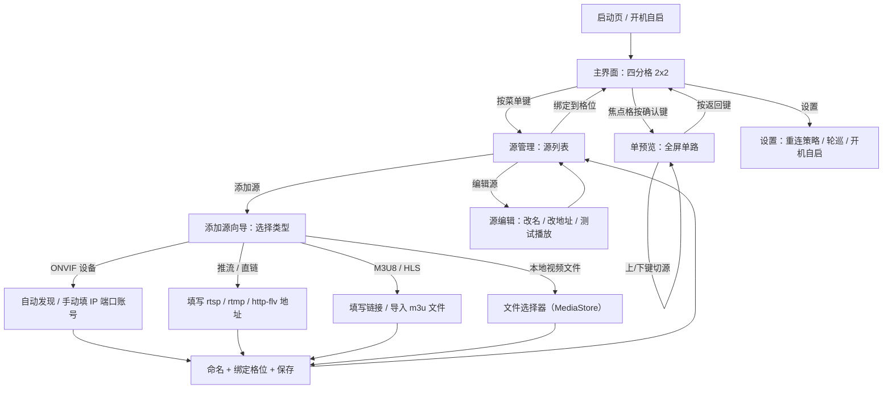

# PRD：TV 监控四分格播放器（tv-monitor）

## 1. 文档信息（项目信息）

| 项目 | 内容 |
|---|---|
| 产品/项目名称 | tv_monitor（TV 监控四分格播放器） |
| 文档版本 | v1.0 |
| 日期 | 2026-10-24 |
| 作者 | 许清楚（产品经理） |
| 状态 | 待评审（将转交架构师） |
| 界面/文档语言 | 简体中文 |
| 技术栈 | Android TV 原生应用：Kotlin + media3 ExoPlayer 播放内核（因用户明确要求"安卓 TV app"，不采用默认 Web 技术栈） |
| 目标平台 | Android TV 7.0+，电视/盒子，D-pad 遥控器操作优先 |

**原始需求复述（逐字）**："开发一个具有监控录像机单预览功能的安卓tv app，能通过添加onvif和推流和m3u8和视频文件的4分格播放软件"

---

## 2. 产品目标与背景

### 2.1 背景

铝厂车间安全管理人员需在车间电视大屏上长时间监看多路监控画面。现有方案存在明显痛点：

- 商用 NVR/硬盘录像机上墙成本高，且新增"外部视频源"（集团推流、环保平台 HLS）能力弱；
- 电脑+浏览器方案不适配电视大屏与遥控器操作；
- 无法把 ONVIF 摄像头、推流直链、M3U8、本地视频文件等异构来源汇聚到同一块屏幕。

### 2.2 产品目标（3 个正交目标）

1. **同屏多路监控**：在 Android TV 上以 2x2 四分格同屏播放 4 路视频，7x24 长时间稳定运行，作为低门槛的"大屏监控墙"替代低端 NVR 方案。
2. **单路预览体验**：仿监控录像机交互——焦点格按确认键进入全屏单预览，随时返回四分格，满足"重点盯一路、全局览四路"的安全巡检需求。
3. **异构视频源统一管理**：统一纳管 ONVIF 设备、推流直链、M3U8/HLS、本地视频文件四类来源，支持自动发现与批量导入，把配置门槛降到"会用遥控器"即可。

### 2.3 成功指标（可度量）

- 四分格连续播放 7x24 无崩溃、无内存泄漏；
- 单路断线后 10 秒内自动恢复播放；
- 4 路 1080p@25fps 同屏解码时 UI 操作响应 < 200ms，低端盒子（2GB RAM）可运行。

---

## 3. 目标用户与典型使用场景

### 3.1 目标用户

- **主要用户**：工厂车间/仓库/商铺的安全管理人员。不懂监控协议细节，通过电视遥控器（D-pad）操作，追求"开机就能看"。
- **次要用户**：小型安防集成商。为客户端快速部署大屏监控，需要批量导入与多布局能力。

### 3.2 场景故事

**场景一：车间大屏日常监看（核心场景）**

铝厂车间安全员张师傅接班后打开车间电视，App 自动加载四分格默认布局：熔铸车间东/西、包装区、成品库四路 ONVIF 摄像头。他用遥控器方向键把焦点移到东南角画面，发现包装区有异常，按下确认键全屏单预览该路，放大细看 3 分钟后按返回键回到四分格，继续全局巡视。整个班次无人值守，画面持续播放。

**场景二：异构视频源汇聚对比监看**

安全主管需在同一块大屏同时查看：本厂 2 路摄像头（ONVIF）+ 集团总部下发的演示推流（rtsp 直链）+ 环保监测平台提供的 HLS 直播流（m3u8）。他按菜单键进入源管理，手动添加推流地址、粘贴 m3u8 链接，将新源绑定到空格位，约十分钟完成部署，无需新增任何硬件。

---

## 4. 用户故事（含验收要点）

| 编号 | 用户故事 | 验收要点 |
|---|---|---|
| US-01 | As a 车间安全员，I want 在电视大屏同屏看到 4 路监控画面，so that 我不切换就能掌握车间全局。 | 进入主界面即按 2x2 播放 4 路；每路独立解码、独立启停；任一路黑屏/无信号不影响其他三路 |
| US-02 | As a 车间安全员，I want 对焦点格按确认键全屏放大该路，so that 我能看清细节并快速返回四分格。 | 焦点格有明显高亮描边；确认键进入单预览（<1s）；返回键回四分格且四路播放不中断；单预览内可切上一路/下一路 |
| US-03 | As a 安全员，I want 自动发现或手动添加 ONVIF 摄像头，so that 我不懂协议也能接入厂里摄像头。 | WS-Discovery 组播扫描列出网内设备（名称/IP/端口）；支持手动填 IP/端口/账号密码；连接成功后拉取设备信息（厂商/型号）与主/子码流地址列表供选择 |
| US-04 | As a 安全员，I want 手动填写 rtsp/rtmp/http-flv 等直链地址，so that 我能接入集团下发或平台方提供的直播流。 | 输入框支持粘贴长地址；保存时校验协议头与连通性（可配置超时）；播放失败给出明确错误提示（超时/404/协议不支持） |
| US-05 | As a 安全员，I want 添加 m3u8 直播链接并导入 m3u/m3u8 播放列表文件，so that 我能批量接入环保平台等多路 HLS 源。 | 支持单条 m3u8 URL 添加；支持从本地/U 盘选 .m3u/.m3u8 文件解析并批量添加；导入结果汇总成功/失败数量与原因 |
| US-06 | As a 安全员，I want 选择电视本地或 U 盘里的视频文件播放，so that 我能播放录制视频或宣传片填充画面。 | MediaStore 扫描列出视频文件（名称/时长/大小）；文件选择器可浏览 U 盘；选中后循环播放；常见格式以 media3 能力为准 |
| US-07 | As a 安全员，I want 视频断线后自动重连，so that 长时间无人值守大屏不出现永久黑屏。 | 断流时显示重连提示与倒计时；指数退避重试（5s/10s/20s，上限 60s）；恢复后自动续播；连续失败（默认 10 次，可配置）后保留错误态并持续后台重试 |
| US-08 | As a 安全员，I want 管理已添加的视频源，so that 我能改名、改地址、删除失效源、绑定到四分格位置。 | 源列表展示名称/类型/地址/状态；支持编辑、删除、测试播放；每格可绑定一个源；绑定关系持久化（重启后恢复） |
| US-09 | As a 安全员，I want 单路静音/取消静音，so that 我听某一路的声音而不被其他路干扰。 | 默认四路全部静音；焦点格按静音键仅取消该路静音；切格/切屏后静音状态不串台 |
| US-10 | As a 安全员，I want 看到当前路的分辨率/码率/延迟信息，so that 我判断画面是否正常。 | 单预览或聚焦态按 info 键浮现 overlay：分辨率、帧率、视频/音频码率、缓冲延迟、丢帧统计，3s 自动隐藏 |

---

## 5. 功能需求池（P0/P1/P2）

### 5.1 P0（Must have）

**FR-P0-01 四分格播放布局**
- 描述：主界面以 2x2 网格同屏渲染 4 路视频，每路一个独立播放器实例；支持格位换源与默认布局加载。
- 验收标准：四路同屏播放；某格换源/重启不影响其他三路；画面保持宽高比（letterbox），无拉伸变形、无布局闪烁。

**FR-P0-02 单预览模式**
- 描述：焦点格按确认键进入全屏单路预览；返回键回到四分格；单预览内支持上一路/下一路切换。
- 验收标准：进入/返回 < 1s；返回后四路播放不中断（不重新起流）；单预览显示源名称与播放信息 overlay。

**FR-P0-03 视频源添加（四类）**
- 描述：支持添加 ONVIF 设备（WS-Discovery 自动发现 + 手动 IP/端口）、推流直链（rtsp://、rtmp://、http-flv 等）、m3u8 直链、本地视频文件。
- 验收标准：四类源均可成功添加并播放（协议边界以 media3 及内置能力为准，不支持时给出明确提示）；每类添加流程均有表单校验与错误提示。

**FR-P0-04 视频源管理**
- 描述：源列表管理（增删改查、测试播放、实时状态显示）；源与四分格格位绑定并持久化。
- 验收标准：重启 App 后布局与绑定关系恢复；删除正在播放的源时，对应格显示"未配置"占位而非崩溃。

**FR-P0-05 断线自动重连**
- 描述：播放异常/断流自动重连（指数退避），并提供手动重试入口。
- 验收标准：同 US-07；重连期间其他三路不受影响；重连状态在界面可见。

**FR-P0-06 D-pad 遥控器交互**
- 描述：全界面支持遥控器方向键/确认键/返回键/菜单键，焦点可见且移动顺序符合电视直觉；触摸屏为次要支持。
- 验收标准：核心流程（进入单预览、添加源、管理源）可仅用遥控器完成；无焦点丢失/卡死；输入框适配 TV 输入法。

### 5.2 P1（Should have）

**FR-P1-01 PTZ 云台控制**
- 描述：ONVIF 设备支持 PTZ 云台控制（方向、缩放、预置位调用），在单预览态操作。
- 验收标准：单预览内呼出云台面板；方向键控制云台转动并有操作反馈；设备不支持 PTZ 时面板隐藏或置灰提示。

**FR-P1-02 轮巡/轮播**
- 描述：四分格支持定时轮巡（按间隔自动切换每格源或轮换布局）；支持单预览轮播（按顺序逐路全屏播放）。
- 验收标准：轮巡间隔可配置（5s/10s/30s）；轮巡中有状态指示；按任意键可暂停/退出。

**FR-P1-03 m3u 批量导入**
- 描述：导入本地 .m3u/.m3u8 播放列表文件，解析条目批量加入源库。
- 验收标准：容忍解析失败行并报告原因；导入后源进入源列表；重复条目去重或提示。

**FR-P1-04 源分组**
- 描述：源按分组（车间/楼层/区域）归类，支持按组快速绑定布局。
- 验收标准：分组可增删改名；源列表可按分组筛选；四分格可一键套用某分组前 4 个源。

**FR-P1-05 布局保存与切换**
- 描述：保存多套四分格布局方案（如"早班布局"/"夜班布局"），快速切换。
- 验收标准：≥2 套布局的保存/切换/删除；切换后各格重新加载对应源。

### 5.3 P2（Nice to have）

**FR-P2-01 本地录像与截图**
- 描述：对当前路截图保存；单预览下可手动录制片段到本地存储。
- 验收标准：截图/录像文件可在 App 内或文件管理器中找到；文件命名含时间戳+源名。

**FR-P2-02 开机自启**
- 描述：电视开机后自动启动 App 并加载默认布局。
- 验收标准：重启电视后自动进入四分格播放；可在设置中关闭自启。

**FR-P2-03 定时计划**
- 描述：按时间段表切换布局/启停播放（如夜班只留 2 路）。
- 验收标准：支持按周配置时间段与动作；到点自动执行，执行日志可查。

**FR-P2-04 播放状态角标常显**
- 描述：四分格每格角标常显源名+状态（在线/重连中/离线），供远观。
- 验收标准：角标字号在 3 米外可辨识；异常状态有颜色区分。

---

## 6. 非功能需求

**NFR-01 稳定性（7x24）**
- 连续运行 7x24 无崩溃、无内存泄漏（内存增长基线由架构师定标）；
- 异常单路播放器崩溃不影响其他三路：播放器实例相互隔离，单路失败降级为错误占位画面。

**NFR-02 性能约束**
- 4 路 1080p@25fps 同时解码（软解/硬解混合）时 UI 帧率 ≥ 30fps；
- 单路起流到首帧 ≤ 3s（HLS 视首段时长可放宽至 5s）；
- 在 2GB RAM 低端盒子上可运行，内存占用有明确上限。

**NFR-03 兼容性**
- Android TV 7.0+（minSdk 以媒体能力实测为准）；
- 适配 720p/1080p/4K 分辨率与 UI 缩放；
- 兼容 D-pad 遥控器为主、触摸屏为辅的输入方式。

**NFR-04 网络与容错**
- 弱网/断网下四路独立重连，互不阻塞；
- 单路坏流（伪 rtsp、损坏 m3u8）不导致整体卡死；
- 网络恢复后自动续播。

**NFR-05 安全与合规**
- ONVIF 账号密码本地加密存储（Android Keystore）；
- 不收集、不上传用户数据；仅访问局域网摄像头与用户主动添加的地址。

**NFR-06 可维护性**
- 播放内核统一 media3 ExoPlayer；
- 视频源抽象为统一 Source 接口族，新增协议不侵入 UI 层；
- 日志可开关（adb logcat + 应用内查看入口）。

---

## 7. UI 设计稿

### 7.1 界面流转图（Mermaid）



### 7.2 各界面文字线框与 D-pad 焦点走向

**（1）主界面：四分格 2x2**

```
+--------------------------- TV 大屏 ---------------------------+
| [格1：熔铸车间东]          | [格2：熔铸车间西]                 |
|   视频画面 (16:9)          |   视频画面                        |
|   角标：源名 / 在线状态     |   角标                            |
|----------------------------+----------------------------------|
| [格3：包装区]              | [格4：成品库]                     |
|   视频画面                 |   视频画面                        |
|                            |                                  |
+----------------------------------------------------------------+
| 底部提示条：确认=单预览    菜单=源管理    设置=系统设置          |
+----------------------------------------------------------------+
```

- D-pad 焦点：方向键在 2x2 网格内移动焦点格（上/下/左/右），焦点格加 3px 主题色描边高亮；
- 确认键 → 进入单预览；菜单键 → 源管理；返回键 → 弹出退出确认（防止误退出）。

**（2）单预览：全屏单路**

```
+--------------------------- TV 大屏 ---------------------------+
| 源名称：包装区 CAM-03     [1080p | 25fps | 4Mbps | 380ms]      |
|                                                                |
|                    全屏视频画面（保持宽高比）                    |
|                                                                |
| [静音图标]        [云台面板(P1)]        [信息 overlay]          |
+----------------------------------------------------------------+
| 底部：返回=四分格    上/下=切换上一路/下一路    确认=播放/暂停   |
+----------------------------------------------------------------+
```

- D-pad 焦点：默认无 UI 抢焦点（沉浸观看）；按 info 键显示信息 overlay 3s 后自动隐藏；
- 左/右键切上一路/下一路；返回键退回四分格；静音键仅作用于当前路。

**（3）源管理：源列表**

```
+--------------------------- TV 大屏 ---------------------------+
| 源管理                          [ + 添加源 ]   [分组筛选 v]     |
+----------------------------------------------------------------+
| > 熔铸车间东    ONVIF   192.168.1.61           ● 在线          |
|   包装区 CAM-03 ONVIF   192.168.1.63           ● 重连中        |
|   集团演示流    推流    rtsp://...              ● 在线          |
|   环保 HLS      M3U8    https://...m3u8        ● 离线          |
|   安全宣传片    本地    /usb/media.mp4         ● -              |
+----------------------------------------------------------------+
| 确认=播放测试    菜单键=编辑/删除    返回=主界面                 |
+----------------------------------------------------------------+
```

- D-pad 焦点：列表上/下移动焦点行；"添加源"按钮固定为列表首行特殊项，保证第一个焦点即可达；
- 菜单键对焦点行弹出操作菜单（编辑/删除/绑定到格位）。

**（4）添加源向导**

```
步骤 1：选择源类型
+----------------------------------+
| > [ONVIF 设备]                   |
|   [推流 / 直链]                  |
|   [M3U8 / HLS]                   |
|   [本地视频文件]                 |
+----------------------------------+

步骤 2a（ONVIF）：[自动发现] 扫描结果列表  /  手动填 IP、端口、账号、密码
步骤 2b（推流）：输入地址 + [测试连接] + [保存]
步骤 2c（M3U8）：输入 URL  /  [导入 .m3u / .m3u8 文件]
步骤 2d（本地）：文件选择器（MediaStore 扫描 + U 盘浏览）

步骤 3：命名 → 选择加入的格位 → 保存
```

- D-pad 焦点：向导内上一步/下一步；输入框获焦后唤起 TV 输入法；返回键 = 取消并回上一步。

---

## 8. 风险与待确认问题

1. **"推流"范围确认（影响 P0 边界）**：用户原话"推流"指向不明，本 PRD 按"拉流直链"实现（rtsp://、rtmp://、http-flv 拉流播放）。其中 RTMP 拉流与 HTTP-FLV 拉流超出 media3 原生能力，需自研或引入第三方协议模块。若不需要，P0 边界收窄为 rtsp + hls + 本地文件。请确认。
2. **是否需要云台（PTZ）**：PTZ 目前列为 P1。若车间点位均为固定枪机，建议移出范围以降低开发成本。请确认。
3. **是否需要账号/权限体系**：当前 PRD 假设单用户本机使用、无账号体系。若需区分管理员/操作员（如禁止操作员删源、改配置），需补充权限矩阵与登录设计。
4. **车间局域网带宽**：4 路 1080p 同屏约需 16-20Mbps 带宽。是否需要"子码流优先"策略（ONVIF 默认选子码流、m3u8 多码率自适应）？建议结合现场网络调研确认。
5. **TV 系统休眠策略**：电视长时间静止可能被系统熄屏/休眠导致播放中断，需要 WakeLock 策略与系统设置引导。待架构师与联调测试确认。
6. **本地视频格式边界**：ts/mkv 等容器与 H.265 编码的播放能力依赖芯片硬解，验收标准需以目标机型实测为准。

---

*本文档转交架构师进行技术方案设计；P1/P2 范围可在迭代中按需裁剪。*
