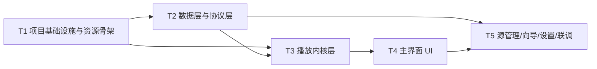

# TASKS：tv-monitor 任务分解（有序实现清单）

| 项目 | 内容 |
|---|---|
| 文档版本 | v1.0 |
| 日期 | 2026-10-24 |
| 作者 | 高见远（软件架构师） |
| 依据 | `docs/ARCHITECTURE.md` v1.0 + `docs/PRD.md` v1.0（含主理人 6 项裁决） |
| 任务数 | 5 个（T1–T5），按实现顺序排列：基础设施 → 数据/协议 → 播放内核 → 主界面 UI → 源管理/设置/联调 |

## 任务总览

| 任务 | 名称 | 层 | 依赖 | 优先级 | 预计工期 |
|---|---|---|---|---|---|
| T1 | 项目基础设施与资源骨架 | 构建/入口/资源 | — | P0 | 2d |
| T2 | 数据层与协议层（ONVIF/M3U/存储） | data/onvif | T1 | P0 | 5d |
| T3 | 播放内核层（四路管理/单路隔离/协议解析） | playback | T1, T2 | P0 | 5d |
| T4 | 主界面 UI（四分格 + 单预览 + D-pad 焦点） | ui/main | T3 | P0 | 4d |
| T5 | 源管理 / 添加向导 / 设置 + 集成联调 | ui/source+settings | T2, T4 | P0 | 6d |

> 依赖包清单见 `ARCHITECTURE.md §1`（含 media3 各模块、OkHttp、协程、kotlinx.serialization 及版本理由）；跨文件共享约定见 `ARCHITECTURE.md §11`，所有任务必须遵守。

---

## T1 项目基础设施与资源骨架

- **目标**：搭建可编译、可安装、可启动的 Android TV 工程骨架；完成构建配置、清单、Application 入口、全局工具（日志/Result）、基础值资源与 drawable。本任务不写任何业务逻辑。
- **涉及文件**（14 个）：
  - `settings.gradle.kts`、`build.gradle.kts`、`gradle.properties`、`gradle/libs.versions.toml`、`gradle/wrapper/gradle-wrapper.properties`、`app/build.gradle.kts`、`app/proguard-rules.pro`
  - `app/src/main/AndroidManifest.xml`、`app/src/main/res/xml/network_security_config.xml`
  - `app/src/main/java/com/tvmonitor/TvMonitorApp.kt`
  - `app/src/main/java/com/tvmonitor/util/Common.kt`（`TvLog` + `AppResult<T>` + 常量）
  - `app/src/main/res/values/strings.xml`、`app/src/main/res/values/themes.xml`、`app/src/main/res/drawable/`（`slot_focus_border.xml`、`status_dot.xml`、`overlay_scrim.xml`、`ic_placeholder.xml` 等）
- **依赖任务**：无
- **优先级**：P0
- **验收标准**：
  1. `./gradlew :app:assembleDebug` 成功，APK 可安装到 Android TV（7.0+ 模拟器或真机）并启动，TV 启动器（LEANBACK_LAUNCHER）可见本应用；
  2. minSdk 24 / targetSdk 34 / compileSdk 35、Kotlin 2.0.x、viewBinding 均生效，无编译警告阻塞；
  3. `TvLog` 开关（`BuildConfig.DEBUG` 初值）生效，TAG 规范为 `TvMonitor:<模块>`；`AppResult` 可供后续任务直接使用；
  4. 清单包含全部 P0 权限与 `usesCleartextTraffic`（内网 http 必须放通，ONVIF SOAP 依赖）；Activity 锁定横屏；
  5. `network_security_config.xml` 允许 cleartext；主题为深色 TV 风格（监控大屏场景）；
  6. 资源命名符合 §11 约定（strings 无硬编码进代码的路径、drawable 前缀规范）。

## T2 数据层与协议层

- **目标**：完成全部数据模型、源库持久化（含 Keystore 密码加密）、M3U 解析、ONVIF 发现与 SOAP 客户端；本层可完全脱离 UI 独立测试。
- **涉及文件**（7 个）：
  - `app/src/main/java/com/tvmonitor/data/model/Models.kt`
  - `app/src/main/java/com/tvmonitor/data/SourceStore.kt`（接口 + `JsonSourceStore`）
  - `app/src/main/java/com/tvmonitor/data/CredentialCrypto.kt`
  - `app/src/main/java/com/tvmonitor/data/m3u/M3uParser.kt`
  - `app/src/main/java/com/tvmonitor/onvif/OnvifSoap.kt`
  - `app/src/main/java/com/tvmonitor/onvif/OnvifDiscovery.kt`
  - `app/src/main/java/com/tvmonitor/onvif/OnvifClient.kt`（含 `OnvifPtzClient` 接口与 NoOp 实现）
- **依赖任务**：T1
- **优先级**：P0
- **验收标准**：
  1. **JVM 单测**：`M3uParser` 覆盖——正常 EXTINF 属性解析（单/双引号/无引号）、相对地址拼接、重复去重、坏行容错、rtmp/flv 标记 UNSUPPORTED、GBK 降级；`JsonSourceStore` 覆盖——增删改查、原子写（中途 kill 不损坏）、重启加载恢复、`Flow` 变更通知、schema 版本校验；
  2. **设备/仪器测试**：`CredentialCrypto` 加解密往返一致，密文不含明文片段；
  3. **ONVIF 真机或 onvif-device-tool 模拟器**：`discover()` 4s 内列出网内设备（名称/IP）；`getDeviceInfo/getProfiles/getStreamUri` 链路成功返回主/子码流；错误密码返回明确 `AUTH_FAILED` 错误码（不崩溃、不泄漏明文密码到日志）；
  4. SOAP Fault 能识别并转为 `AppError`；XmlPullParser 流式解析（无 DOM 大响应）；
  5. 裁剪边界落地：未实现的能力（事件订阅/录像回放/PTZ 实控）在接口层有明确空实现或 TODO-P1 标注，不影响编译。

## T3 播放内核层

- **目标**：实现 `QuadPlaybackManager` + `PlaybackSlot` + `SourceUriResolver` 协议扩展点；四路并行播放、单路隔离、指数退避重连、attach/detach 视图切换（播放不中断）、rtmp/flv 明确拒绝。
- **涉及文件**（3 个）：
  - `app/src/main/java/com/tvmonitor/playback/QuadPlaybackManager.kt`（含 `PlayerFactory`）
  - `app/src/main/java/com/tvmonitor/playback/PlaybackSlot.kt`（状态机/ReconnectConfig/PlaybackStats/首帧 watchdog）
  - `app/src/main/java/com/tvmonitor/playback/SourceUriResolver.kt`（接口 + Registry + Rtsp/Hls/File/Direct 四个实现）
- **依赖任务**：T1, T2
- **优先级**：P0
- **验收标准**：
  1. 经临时调试界面/harness 验证：**4 路混合源（rtsp + hls + 本地文件）同屏播放**，画面 letterbox 无拉伸；单格 bind 新源不影响其他三格；
  2. **单路隔离**：对某格执行断网/伪流地址，该格进入 `RECONNECTING→(退避 5s/10s/20s/40s/60s 封顶)`，其余三路播放与 UI 无卡顿；10 次失败后保留 `ERROR` 态 + 手动重试入口 + 后台每 60s 保活重试；网络恢复后自动续播；
  3. **attach/detach 切换**：单预览进入/返回过程中 player 不 stop、不重新 prepare（日志断言无 `prepare` 重入），返回后四路均在播；
  4. `rtmp://` 与 `http*-flv` 输入 → `UNSUPPORTED` + 明确错误文案（"暂不支持该协议"），不崩溃；
  5. **2GB 机型 30 分钟 soak**：4 路 1080p 稳态 PSS ≤ 700MB、1h 增长 ≤ 50MB、UI 操作响应 < 200ms（架构 §6.5 基线）；
  6. 每路独立 scope；首帧 watchdog（RTSP 15s / HLS 25s）生效；LoadControl/TrackSelector 按 §6.2/§6.3 配置并可调。

## T4 主界面 UI（四分格 + 单预览 + D-pad 焦点）

- **目标**：接通 T3 播放内核与主界面：2x2 四分格渲染、焦点矩阵、单预览进入/返回、WakeLock 防休眠、底部提示条。
- **涉及文件**（4 个）：
  - `app/src/main/java/com/tvmonitor/MainActivity.kt`（含 `SinglePreviewOverlay` 内部类、WakeLock、全局按键分发）
  - `app/src/main/java/com/tvmonitor/ui/quad/QuadGridView.kt`（`QuadGridView` + `SlotView`）
  - `app/src/main/res/layout/activity_main.xml`
  - `app/src/main/res/layout/view_slot.xml`
- **依赖任务**：T3
- **优先级**：P0
- **验收标准**：
  1. 进入主界面即按 2x2 播放 4 路（绑定关系来自 T2 存储，空绑定显示"未配置"占位）；
  2. D-pad 在 2x2 焦点矩阵内移动，焦点格 3dp 主题色描边明显；越界不 wrap；无焦点丢失/卡死；
  3. 确认键 **< 1s** 进入单预览，返回键回四分格且**四路播放不中断**（肉眼无黑帧重置、日志无重新起流）；单预览内左右切路、info overlay 3s 自动隐藏、静音键仅作用于当前路（默认四路静音，US-09）；
  4. WakeLock 生效：电视静止不熄屏、系统不休眠导致播放中断（主理人裁决 5）；退后台不释放播放器；
  5. 单路错误/重连时该格显示错误/重连倒计时浮层，不影响其他格渲染；底部提示条常显。

## T5 源管理 / 添加向导 / 设置 + 集成联调

- **目标**：完成源管理 CRUD、四类源添加向导（含 ONVIF 自动发现/码流选择、m3u 导入）、设置项；与主界面联调形成完整 P0 闭环；完成真机联调检查。
- **涉及文件**（7 个）：
  - `app/src/main/java/com/tvmonitor/ui/source/SourceListFragment.kt`（含 `SourceListViewModel`）
  - `app/src/main/java/com/tvmonitor/ui/source/AddSourceFragment.kt`（含 `AddSourceViewModel`）
  - `app/src/main/java/com/tvmonitor/ui/settings/SettingsFragment.kt`
  - `app/src/main/res/layout/fragment_source_list.xml`、`item_source.xml`、`fragment_add_source.xml`、`fragment_settings.xml`
- **依赖任务**：T2, T4
- **优先级**：P0
- **验收标准**：
  1. **仅用遥控器**完成全流程：菜单键进源管理 → 添加源（四类均可）→ 命名 → 选格位 → 保存 → 回主界面该格起播；
  2. ONVIF 向导：自动发现列表 / 手动 IP 表单均可；连接后展示设备信息与主/子码流单选列表，**默认子码流**；密码保存后不明文落盘（抽查 sources.json）；
  3. 推流直链/m3u8/本地文件（SAF 选 U 盘）均可添加；保存时做协议头校验 + 连通性测试（可配置超时）；rtmp/flv 明确提示暂不支持；m3u 导入给出成功/跳过/失败汇总与原因；
  4. 源管理：改名、改地址、删除（删除播放中源 → 对应格显示"未配置"不崩溃）、测试播放（临时 slot）、绑定到格位；重启 App 后布局与绑定恢复（US-08/FR-P0-04）；
  5. 设置项生效：重连策略参数、默认静音、子码流优先、日志开关（开机自启开关预留 P2）；
  6. **联调检查点**：2GB 基准机型 ≥8h 连续播放无崩溃/无 OOM（NFR-01）；≥3 品牌 ONVIF 设备（或模拟器）矩阵通过；1080p/720p/4K 屏 UI 适配无截断；弱网/断网恢复场景四路独立重连互不阻塞。

---

## 任务依赖图

并行建议：T2 完成后 T3 即可开工；T5 的界面部分可在 T4 完成前先用假数据（fake SourceStore）并行开发，最终联调依赖 T4。P1/P2（PTZ、轮巡、分组、布局保存、截图录像、开机自启）不在本任务清单，按 PRD 迭代排期。

## 全局共享约定（摘要，全文见 ARCHITECTURE.md §11）

- 跨层异步返回 `AppResult<T>`，不抛业务异常；错误码集中定义。
- 日志：`TvLog` + `TvMonitor:<模块>` TAG；严禁打印密码/凭据（脱敏）。
- 用户可见文案全部进 `strings.xml`（中文默认）；命名遵循 §11（类 PascalCase / 布局 snake_case 带类型前缀 / id snake_case）。
- 播放器操作必须主线程；网络/IO 在 `Dispatchers.IO`；每路播放独立 scope。
- 持久化 JSON 带 `schema` 版本字段，新增字段给默认值。
- 新增协议只允许扩展 `SourceUriResolver` 实现并注册，不得侵入 UI/管理层。

## 联调与验收里程碑

| 里程碑 | 完成标志 |
|---|---|
| M1（T1 结束） | TV 上可启动空壳 |
| M2（T2 结束） | ONVIF 真机发现/取流成功；M3U 单测全绿 |
| M3（T3 结束） | 4 路混合源同屏 + 单路重连隔离 + 2GB 机型内存基线达标 |
| M4（T4 结束） | D-pad 全流程走通；进退单预览 <1s 且不中断 |
| M5（T5 结束） | P0 全功能闭环；8h soak 通过；进入 P1 迭代 |
